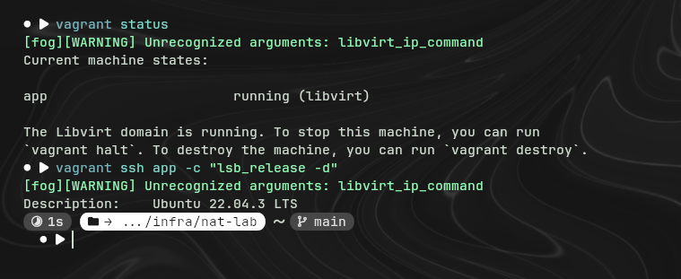
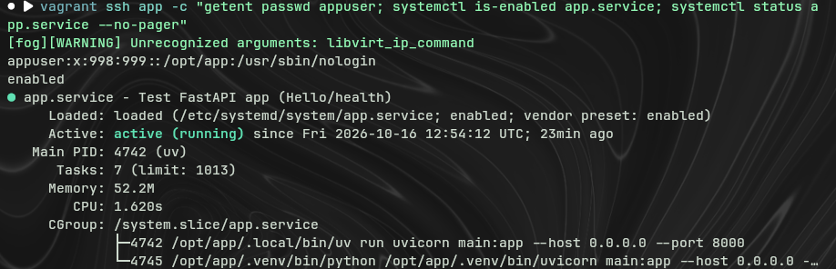
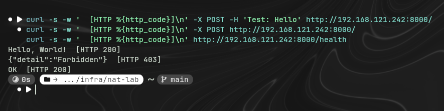

# Пункт b — деплой приложения на VM через systemd

## Задача

Развернуть Python-приложение (`main.py`) на отдельной VM Ubuntu 22.04 так, чтобы оно
работало как systemd-сервис от имени отдельного системного пользователя (не root).

## Как сделано

- **Vagrant** (провайдер **libvirt/KVM**) поднимает VM `app` из бокса `generic/ubuntu2204`.
- **Ansible** (роль `app_deploy`) настраивает VM по SSH при `vagrant up` / `vagrant provision`:
  1. создаёт системную группу и пользователя `appuser` (без шелла, `/usr/sbin/nologin`,
     домашний каталог `/opt/app`);
  2. копирует `main.py`, `pyproject.toml`, `uv.lock` из корня репозитория в `/opt/app`;
  3. ставит [uv](https://docs.astral.sh/uv/) от имени `appuser` и через `uv sync --frozen`
     подтягивает зависимости и нужный Python 3.13 (Ubuntu 22.04 несёт только 3.10, а
     `pyproject.toml` требует `>=3.13` — `uv` сам скачивает нужную версию, без правки
     системных пакетов);
  4. генерирует и включает systemd-юнит `app.service`, который запускает приложение
     через `uv run uvicorn main:app` от имени `appuser`.

## Структура

```
infra/nat-lab/
├── Vagrantfile
├── ansible.cfg
├── ansible/
│   ├── app.yml
│   └── roles/app_deploy/
│       ├── defaults/main.yml
│       ├── handlers/main.yml
│       ├── tasks/main.yml
│       └── templates/app.service.j2
└── reports/
    └── b-systemd-deploy.md   (этот файл)
```

## Как воспроизвести

```bash
cd infra/nat-lab
vagrant up app          # первый запуск: создаёт VM и прогоняет Ansible
vagrant provision app   # повторный прогон Ansible на уже работающей VM
```

## Проверка результата

```bash
$ vagrant ssh app -c "systemctl is-active app.service; systemctl is-enabled app.service"
active
enabled

$ curl -X POST -H 'Test: Hello' http://192.168.121.242:8000/
Hello, World!

$ curl -o /dev/null -w "HTTP %{http_code}\n" -X POST http://192.168.121.242:8000/
HTTP 403

$ curl http://192.168.121.242:8000/health
OK   (HTTP 200)
```

Все три требования пункта **a** (проверяемые теперь на реальной VM, не локально)
и пункта **b** (systemd + отдельный пользователь) выполнены.



## Проблемы по пути и их решения

Основная сложность пункта b оказалась не в самом приложении, а в сетевом окружении
хоста — Ansible не мог достучаться до внешних серверов для `apt`/`uv`. Разобрали по
очереди четыре независимые причины:

1. **Docker ломал NAT других VM.** Docker ставит в iptables/nftables глобальную
   политику `FORWARD DROP` и пропускает только свой трафик. Из-за этого весь трафик
   из libvirt-сети `vagrant-libvirt` молча дропался, хотя правила самого libvirt его
   разрешали.
   Фикс (на хосте, разово): добавить разрешающие правила в специально
   предназначенную для этого цепочку `DOCKER-USER`:
   ```bash
   sudo iptables -I DOCKER-USER -i virbr1 -j ACCEPT
   sudo iptables -I DOCKER-USER -o virbr1 -j ACCEPT
   ```

2. **Мёртвые DNS-сервера, зашитые в Vagrant-бокс.** В `generic/ubuntu2204` статически
   прописаны старые публичные резолверы (`4.2.2.1`, `4.2.2.2`, `208.67.220.220`) сразу
   в двух местах — `/etc/netplan/01-netcfg.yaml` и `/etc/systemd/resolved.conf`.
   Фикс — Ansible-задачи в роли `app_deploy`, которые патчат оба файла на `8.8.8.8`/`1.1.1.1`.

3. **DNSSEC=yes в том же боксе.** Строгая проверка DNSSEC-подписей не проходила через
   данный NAT (скорее всего из-за больших DNSSEC-ответов). Для лабораторного стенда
   DNSSEC не требуется — отключили (`DNSSEC=no`) той же ролью.

4. **Баг Ansible при `become_user` на пользователя без шелла.** При установке `uv` от
   имени `appuser` Ansible пытался выставить права на временные файлы через
   BSD/macOS-синтаксис ACL (`chmod +a`), которого нет в Linux, и падал с ошибкой.
   Фикс — `ansible.cfg` с `allow_world_readable_tmpfiles = True`.

Все четыре фикса находятся в репозитории (`infra/nat-lab/ansible/...`, `ansible.cfg`)
и применяются автоматически при `vagrant provision` — руками на новой машине
повторять их не нужно, кроме пункта 1 (правила `DOCKER-USER` — это настройка хоста,
а не VM, и не входит в Ansible-провижининг).
